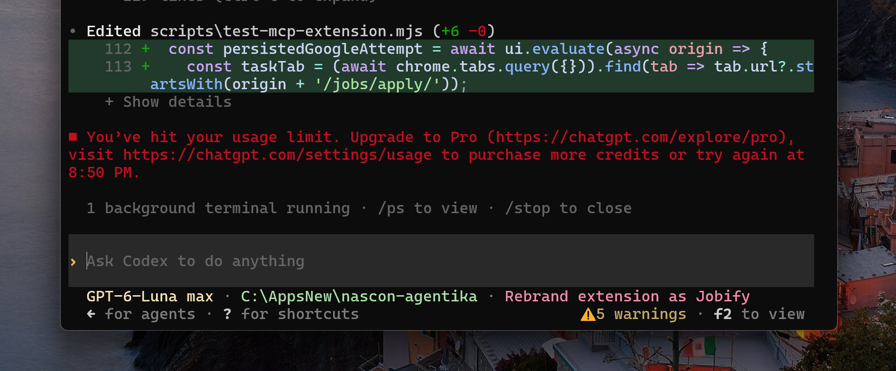
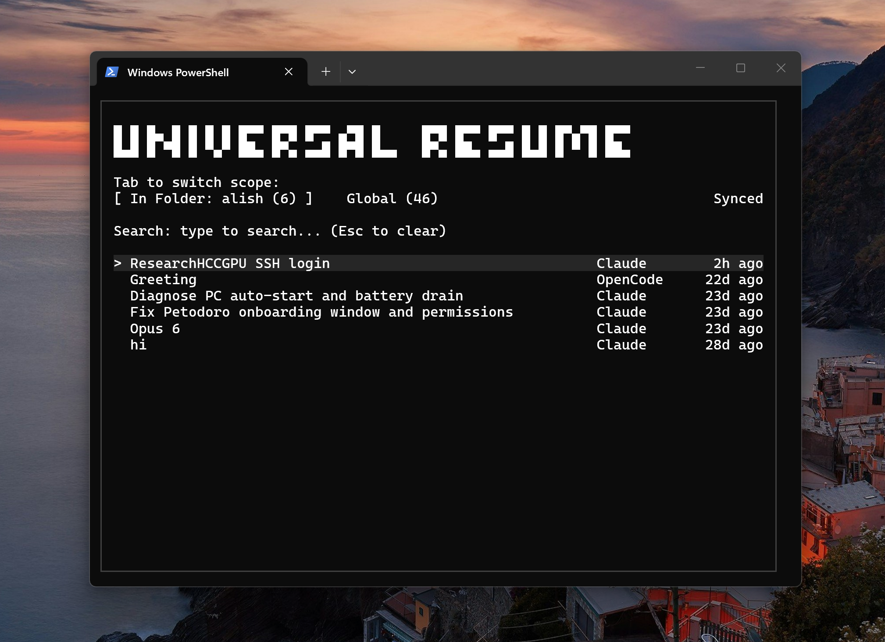
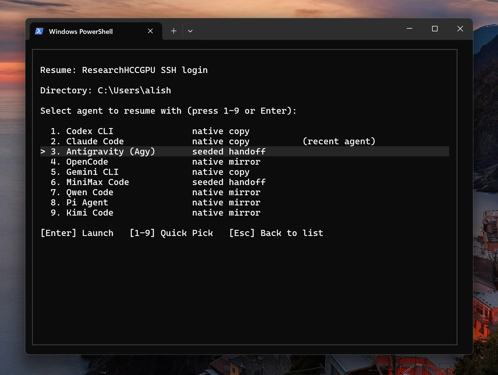
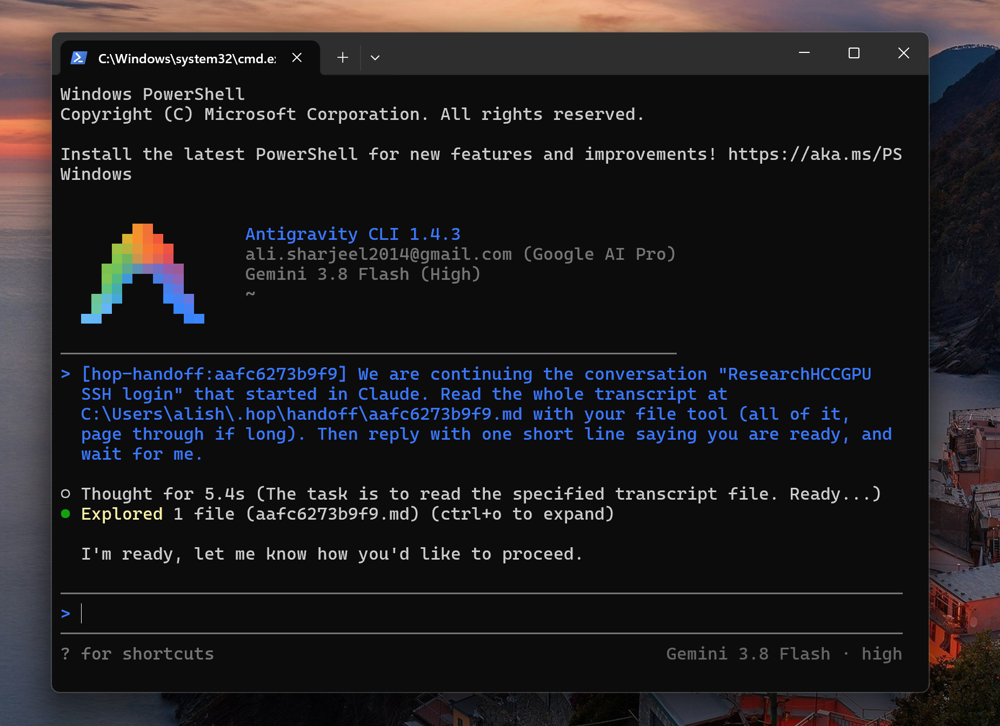

<h1 align="center">Universal Resume</h1>

<p align="center">
Type <code>resume</code> in any terminal. See all your coding conversations across agents. Pick any chat, choose which agent you want to resume it with, and keep coding without missing a beat—even when an agent hits its usage limit.
</p>

<p align="center">
  
  
  <br>
  <sub>Hit usage limit &nbsp;&bull;&nbsp; Universal Resume session list</sub>
</p>

<p align="center">
  
  
  <br>
  <sub>Choose agent to resume &nbsp;&bull;&nbsp; Seamless continuation in Antigravity</sub>
</p>

<p align="center">
Built with <a href="https://github.com/anomalyco/opentui">OpenTUI</a>.
</p>

---

## Quick Install (One-Liner)

### Windows (PowerShell)
```powershell
irm https://raw.githubusercontent.com/AliSharjeell/UniversalResume/main/install.ps1 | iex
```

### macOS & Linux (Terminal)
```bash
curl -fsSL https://raw.githubusercontent.com/AliSharjeell/UniversalResume/main/install.sh | bash
```

Once installed, just write:
```bash
resume
```

---

## Why Universal Resume?

- **Hit rate limits on Claude?** Instantly switch to **Codex**, **Cursor CLI**, **Grok Build**, or **Antigravity**.
- **Started in Codex?** Hop into **Claude Code**, **DeepSeek Harness**, **Hermes**, or **OpenClaw** with full history and context preserved.
- **Zero copy-pasting:** Every conversation across 15 coding agents is automatically tracked and mirrored into each agent's native format, so every hop opens a session that already holds the whole thread.
- **Run anywhere:** Works in any directory, terminal, or shell on Windows, macOS, and Linux.

---

## Supported Agents

| Coding Agent | CLI Command | Resume Mode |
|---|---|---|
| **Claude Code** | `claude` | Native session resume |
| **Codex CLI** | `codex` | Native session resume |
| **Cursor CLI** | `cursor-agent` / `cursor` | Native session resume |
| **Antigravity CLI** | `agy` | Native session resume |
| **Grok Build** | `grok` | Native session resume |
| **DeepSeek Harness** | `deepseek` | Native session resume |
| **Hermes Agent** | `hermes` | Native session resume |
| **OpenClaw** | `openclaw` | Native session resume |
| **Aider** | `aider` | Native session resume |
| **OpenCode** | `opencode` | Native session resume |
| **OpenHands** | `openhands` | Native session resume |
| **Qwen Code** | `qwen` | Native session resume |
| **Kimi Code** | `kimi` | Native session resume |
| **MiniMax Code** | `minimax` | Native session resume |
| **Pi Agent** | `pi` | Native session resume |

Every hop writes the chat into the agent's own store first, then opens it with that agent's
own resume command. `hop resume <agent> --handoff` still seeds a fresh conversation instead.

---

## TUI Features & Keybindings

- **Auto-Sync on Start:** Every time you open `resume`, it automatically pulls fresh turns from all installed coding agents in the background.
- **Manual Sync Button:** Click `[Sync (S)]` or press `s` / `Ctrl+S` anytime to re-sync active sessions on the fly.
- **Instant Search:** Start typing anywhere to filter chats by title, recent agent, or project folder.
- **Scope Toggle (Tab):** Press `Tab` to switch between chats for the current folder and all projects across your machine.
- **Live Inspector:** Inspect participant agents, turn metrics, active mirror statuses, and transcript snippets before launching.

| Key | Action |
|---|---|
| `↑` / `↓` | Navigate conversation list |
| `Enter` | Choose conversation & open Agent Picker |
| `1`–`9` | Quick-launch agent immediately |
| `Tab` | Toggle between Current Folder & All Projects |
| `s` or `Ctrl+S` | Trigger manual session sync |
| `[Sync]` | Click with mouse to sync |
| Type text | Live fuzzy / substring filter |
| `Backspace` | Erase search character / Back |
| `Esc` | Clear search / Back / Exit |

---

## License

MIT © [Ali Sharjeel](https://github.com/AliSharjeell)
